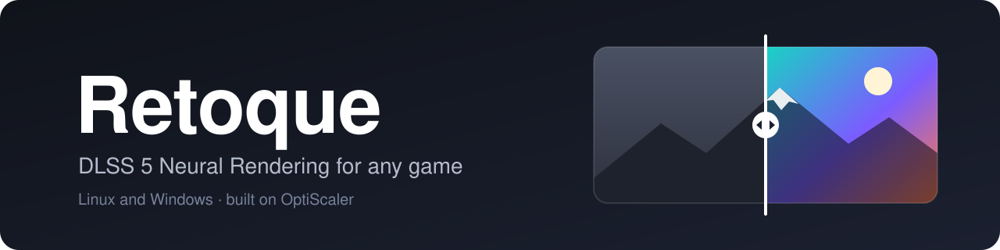
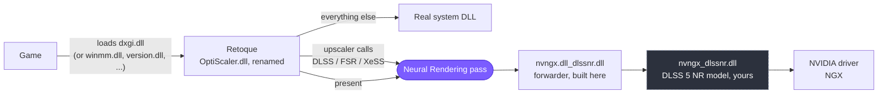
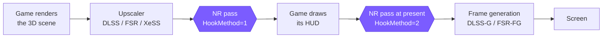
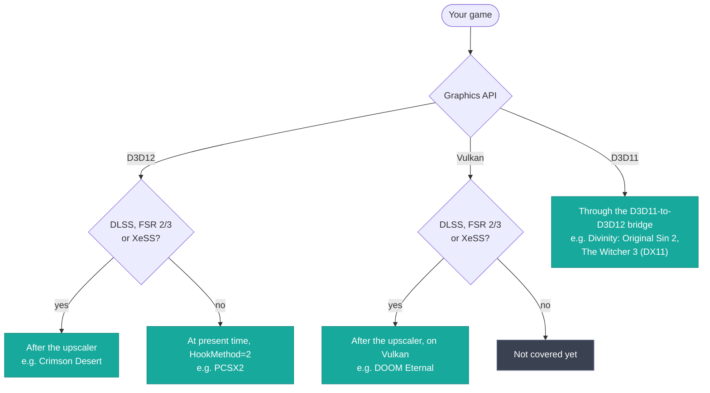
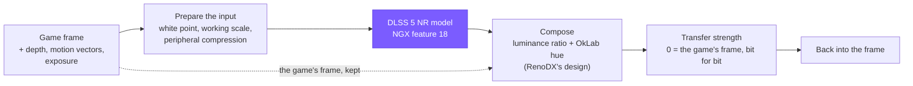

<div align="center">

  

</div>
<hr />
<br />
<div align="center">
  <a href="https://github.com/gabrielmaialva33/retoque/actions/workflows/nr-tests.yml"></a>
  
  
  <a href="LICENSE"></a>
  <a href="https://github.com/optiscaler/OptiScaler"></a>
</div>
<br />

## Table of Contents

**1.** [**About**](#about)  
**2.** [**How it works**](#how-it-works)  
**3.** [**Where the pass runs**](#where-the-pass-runs)  
**4.** [**Inside the pass**](#inside-the-pass)  
**5.** [**Status**](#status)  
**6.** [**Requirements**](#requirements)  
**7.** [**Installation**](#installation)  
**8.** [**Using it**](#using-it)  
**9.** [**Building and tests**](#building-and-tests)  
**10.** [**Repository layout**](#repository-layout)  
**11.** [**Credits**](#credits)  
**12.** [**License**](#license)

## About

**Retoque** runs NVIDIA's **DLSS 5 Neural Rendering** model over a game's picture, in games that never
shipped with it. It is a fork of [**OptiScaler**](https://github.com/optiscaler/OptiScaler), by way of
[Dagherbou's DLSS-NR fork](https://github.com/Dagherbou/OptiScaler_DLSSNR), so it loads the same way: as a
proxy DLL between the game and the graphics API, with no game patch and no cooperation from the game.
Everything OptiScaler does (swapping upscalers, frame generation, spoofing) is still here; see
[OptiScaler's README](https://github.com/optiscaler/OptiScaler#readme) for that side.

> [!IMPORTANT]
> Retoque does **not** include the Neural Rendering model. You supply `nvngx_dlssnr.dll` yourself
> (see [Requirements](#requirements)).

> [!WARNING]
> Experimental, and unsupported by NVIDIA. It drives an undocumented NGX feature directly. Back up the
> game folder's files before you install, and keep the game's own copies of any DLL you replace.

**Key aspects of Retoque:**
- Runs the model on four routes: after the game's upscaler on **D3D12**, after the upscaler on
  **Vulkan**, on **D3D11** games through a D3D11-to-D3D12 bridge, and **at present time** for games with
  no upscaler at all (emulators included).
- Games with DLSS, FSR 2/3 or XeSS all qualify for the upscaler routes, because OptiScaler turns their
  calls into the same path.
- **Linux / Proton first**: Vulkan hook skipping, overlay routing and a vkd3d-proton / DLSS-G interlock,
  on top of everything that works on Windows.
- **Colour that stays the game's**: RenoDX-style composition, a white point from the game's own
  exposure, optional highlight recovery. At strength zero the frame comes back **bit for bit**.
- **Cost controls**: working scale, peripheral compression and model cadence, with fence-confirmed GPU
  timing and per-kernel profiling to measure them.
- **Frame generation aware**: the pass runs before frame generation sees the frame, and frame
  generation can be synthesized for games that give no motion vectors.
- An in-game menu with side-by-side and wipe comparison, and a host test suite that runs without a GPU.

## How it works

Like OptiScaler, Retoque is one DLL that the game loads under a system DLL's name. It forwards
everything to the real system DLL, except the calls it is interested in: the game's upscaler calls and
its presents. That is where the Neural Rendering pass runs.



> [!NOTE]
> **Why a forwarder?** The model only answers callers whose module path contains `nvngx.dll`, so its
> calls go through `nvngx.dll_dlssnr.dll`, a small DLL built by this project. It contains no NVIDIA
> code. On D3D12, `[DlssNr] ModelLoader=direct` makes the same calls from `OptiScaler.dll` instead.

## Where the pass runs

A frame goes through the same stages in almost every game. Retoque can step in at two points: right
after the upscaler, while the picture is still linear and the HUD is not drawn yet, or at present time,
on the finished picture just before frame generation.



`HookMethod=1` (the default) leaves the HUD untouched, because the HUD is drawn after the pass.
`HookMethod=2` covers games with no upscaler, and sees the finished picture, HUD included.

**Which route does my game take?**



> [!TIP]
> A D3D11 game with no upscaler runs the pass on the bridge's own swapchain with `HookMethod=2`; that is
> decided when the swapchain is created, so changing it needs a restart. A D3D11 game that has an
> upscaler gets the pass when OptiScaler runs that upscaler through the bridge (one of the "w/Dx12"
> upscalers in its menu).

## Inside the pass

The model never sees the game's frame directly. Retoque prepares an input for it, runs it, and composes
the answer back into the game's own picture, keeping the game's colours and highlights.



Optional stages, all off or neutral by default:

- **Model cadence** runs the model on one frame in N and carries its result along the motion vectors in
  between. An FPS option; it costs some stability in motion.
- **Output stabilizer** holds still pixels steady, gated by the model's input, so moving pixels always
  show the current answer.
- **Highlight recovery** (from RTX Remix) keeps bright highlights closer to the game's frame.

## Status

Measured working on Linux (Proton, RTX 4090):

| Game | Route |
|---|---|
| Crimson Desert | after the upscaler (D3D12), with DLSS-G |
| Divinity: Original Sin 2 | D3D11 bridge, with synthesized frame generation |
| The Witcher 3 (DirectX 11) | D3D11 bridge |
| DOOM Eternal | Vulkan, plus the menu overlay |
| PCSX2 | D3D12 present pass |

Builds are also run on native Windows with an RTX 3060.

> [!NOTE]
> Proton is not a D3D12 validator: it accepts some calls that Windows rejects. Windows reports are
> especially welcome. HDR10/PQ and scRGB swapchains are declined at present time for now (the game's
> picture is shown untouched) until that conversion exists.

## Requirements

- An **NVIDIA RTX GPU**. The cost depends a lot on the architecture: `WorkingScale=auto` runs the model
  at full scale on RTX 40 and later, and at half scale on RTX 20 and 30.
- **`nvngx_dlssnr.dll`**, the Neural Rendering model, which you supply. The 310.8.2.0 build in common use
  is a community patch of NVIDIA's 310.8.0.0 (NVIDIA's own build is known to fault). Retoque does not
  redistribute either one.
- **`nvngx.dll_dlssnr.dll`**, the forwarder, built by this project.
- A recent NVIDIA driver. Development runs on the Linux 615.78 driver; there is no tested minimum yet.

## Installation

<details open>
<summary><b>Linux (Proton)</b></summary>

1. Copy `OptiScaler.dll`, `OptiScaler.ini`, `nvngx.dll_dlssnr.dll` and your `nvngx_dlssnr.dll` into the
   folder that holds the game's executable.
2. Copy `/usr/lib/nvidia/wine/_nvngx.dll` there too, and refresh it when the driver updates.
3. Rename `OptiScaler.dll` to a name the game loads early: `dxgi.dll`, `winmm.dll`, `version.dll`,
   `dbghelp.dll`, `d3d12.dll`, `wininet.dll` or `winhttp.dll` (or `OptiScaler.asi`). `setup_linux.sh`
   asks and renames it for you.
4. Steam launch options, for a `dxgi.dll` proxy: `WINEDLLOVERRIDES="dxgi=n,b" %command%`
5. Turn the module on in `OptiScaler.ini` (see [Using it](#using-it)).

Native Vulkan games can hit fence timeouts when the Vulkan overlay runs next to DLSS-G under Proton. Set
`[Vulkan] SkipHooks=true` for those.

</details>

<details>
<summary><b>Windows</b></summary>

1. Copy `OptiScaler.dll`, `OptiScaler.ini`, `nvngx.dll_dlssnr.dll` and your `nvngx_dlssnr.dll` beside
   the game's executable.
2. Rename `OptiScaler.dll` to the proxy name (`dxgi.dll`, `winmm.dll`, ...). `setup_windows.bat` does it.
3. Turn the module on in `OptiScaler.ini` (see [Using it](#using-it)).

</details>

> [!CAUTION]
> Keep **one** proxy name per game folder. Two copies loaded together fight over the same hooks and the
> game dies at startup. The log line `CheckWorkingMode OptiScaler working as <name>` says which one
> loaded. If the game's prefix has no `nvapi64.dll` (Divinity is one), point `[Libraries] NvapiPath` at
> Proton's own `files/lib/wine/nvapi/x86_64-windows/nvapi64.dll`.

## Using it

In `OptiScaler.ini`, change the existing keys in place. Do not add a second copy of a key: the parser
keeps the last one.

```ini
[DlssNr]
Enabled=true
ToggleKey=0x76    ; F7 switches the pass on and off (no key by default)
```

> [!TIP]
> * **`Insert`** opens the in-game menu (`[Menu] ShortcutKey`). Its Neural Rendering tab has the options
>   below, the comparison views and the GPU timing row.
> * With `[Log] LogToFile=true`, `OptiScaler.log` beside the game says which route the pass took and
>   why, and carries the model's own messages as `DLSS-NR model:` lines.

Every key lives under `[DlssNr]` and ships as `auto`; the table says what `auto` means.
[`Config.md`](Config.md) and the comments in the ini are the full reference.

| Key | `auto` means | What it does |
|---|---|---|
| `Enabled` | false | Turns the module on. |
| `ToggleKey` | no key | Hotkey that switches the pass on and off. |
| `HookMethod` | 1 | Where the pass runs: 0 auto, 1 on the upscaler's output, 2 at present. |
| `TransferStrength` | 1.0 | How far the frame moves toward the model's picture; 0 gives the game's frame back exactly. |
| `WorkingScale` | 1.0 on RTX 40+, 0.5 on RTX 20/30 | The fraction of the frame the model works at. |
| `WhitePointSource` | 1 | Where the white point comes from: 0 paper white, 1 the game's exposure, 2 an exposure scan. |
| `ModelLoader` | forwarder | `forwarder`, or `direct` (OptiScaler calls the model itself). |
| `HighlightRecovery` | false | Keeps bright highlights closer to the game's frame (from RTX Remix). |
| `Cadence` | 1 | Run the model on one frame in N and carry its result in between (1 is every frame). |
| `StabilizerStrength` | 0 | Holds still pixels steady (0 is off). |
| `GpuTiming` | false | Fence-confirmed GPU timing for the pass. |
| `Compare` | 0 | 1 side by side, 2 wipe (0 is off). |

## Building and tests

Windows-only C++ (MSVC, `OptiScaler.sln`, x64). On Linux, `./build-local.sh` builds with MSVC under Wine
(it runs [`tools/build-local.sh`](tools/README.md)). The Build section of [`CLAUDE.md`](CLAUDE.md#build)
has the details: the Wine stall recovery, formatting with clang-format 22, CI.

> [!WARNING]
> Do not run `git submodule update --init --recursive` blindly: `external/FidelityFX-SDK` is very large
> and is deliberately left unchecked-out.

```bash
python3 tests/run_all.py            # host tier: Python and g++/clang++, about a minute
python3 tests/run_all.py --list     # suites, tiers, and what can run here
python3 tests/run_all.py --tier all # adds the Wine suites
```

The host tier checks decision logic, configuration round-trips, bridge lifetime and more against fakes,
under sanitizers. It says nothing about image quality or performance. The Wine tier builds real DLLs and
drives real D3D12 and Vulkan. See [`tests/README.md`](tests/README.md).

## Repository layout

```text
retoque/          the Neural Rendering module: dlssnr/ (host code), shaders/dlssnr/ (the pass) and
                  shaders/synth_motion/ (the motion estimator for synthesized frame generation)
docs/             design notes (indexed by topic), Linux/Proton notes, guides, history
tools/            build, deploy, release and log-summary scripts
tests/            the test suites and their runner
OptiScaler/       OptiScaler's tree, at upstream's paths so upstream merges stay easy
Config.md         every INI key
```

Start with [`retoque/dlssnr/README.md`](retoque/dlssnr/README.md) for the code,
[`docs/README.md`](docs/README.md) for the documentation, and
[`docs/dlssnr/design/DEVELOPMENT.md`](docs/dlssnr/design/DEVELOPMENT.md) for the rules every change
follows.

## Credits

Retoque stands on other people's work. Full licence texts are in [`Licenses/`](Licenses/).

- **[OptiScaler](https://github.com/optiscaler/OptiScaler)**, created by
  [cdozdil](https://github.com/cdozdil), and its contributors. GPL-3.0.
- **[Dagherbou's OptiScaler_DLSSNR](https://github.com/Dagherbou/OptiScaler_DLSSNR)**, the DLSS-NR fork
  this module started from.
- **[RenoDX](https://github.com/clshortfuse/renodx)** (clshortfuse): the colour composition. clshortfuse
  also made the patched 310.8.2.0 model build.
- **[NVIDIA RTX Remix](https://github.com/NVIDIAGameWorks/dxvk-remix)**: the highlight recovery step.
- **[optimizer-fps-dlss5](https://github.com/BeliyG3/optimizer-fps-dlss5)** (BeliyG3, MIT): the peripheral
  compression mapping and the model cadence carry.
- **[DLSS5-Feeder](https://github.com/jlrouzies-fr/DLSS5-Feeder)** (jlrouzies-fr, MIT): the output
  stabilizer's gate and the reduced-scale guide fixes.
- **[dlss5-bridge](https://github.com/NIGos/dlss5-bridge)** (NIGos, MIT): the NGX loader's feature-18
  route.
- **[OptiScaler-DLSSNR-PreSR-Multipass](https://github.com/wilsjo2/OptiScaler-DLSSNR-PreSR-Multipass)**
  (wilsjo2, GPL-3.0): the direct model loader, DLSS enlargement and the peripheral compression
  integration.
- **[OptiScaler-F5-DLSSNR-Multipass](https://github.com/janblade/OptiScaler-F5-DLSSNR-Multipass)**
  (janblade, GPL-3.0): "Measure detail", per-thread scopes, and the model cadence and ViT-skip ideas.
- **[scottmudge's OptiScaler_DLSSNR](https://github.com/scottmudge/OptiScaler_DLSSNR)**: the present hook
  and descriptor reuse, rewritten here.
- **[Skynizz](https://github.com/Skynizz/optiscaler-dlss5)**, **hhkbble** and **sqmq13**: the exposure
  latch, the residual transfer and signed-value fixes, adapted.
- **[KleberMotta](https://github.com/KleberMotta/OptiScaler-DLSS5-MFG-RTX40)**,
  [ImDreamt](https://github.com/ImDreamt/MFGAdaUnlock-RenoDx),
  [mavismmg](https://github.com/mavismmg/MFGAdaUnlock-RenoDx) and
  [dashdogy](https://github.com/dashdogy/RTX40MFG-Unlock): the DLSS-G snippet rule.
- **[AMD FidelityFX SDK](https://github.com/GPUOpen-LibrariesAndSDKs/FidelityFX-SDK)** (MIT parts): the
  optical flow behind `SynthMotion`.
- **[dxvk-nvapi](https://github.com/jp7677/dxvk-nvapi)** (jp7677): the NVIDIA Optical Flow headers (MIT).
- **y4my4my4m**, **RizziU** and **jackra1n**: Linux/Proton fixes from their OptiScaler pull requests
  ([#1138](https://github.com/optiscaler/OptiScaler/pull/1138),
  [#1131](https://github.com/optiscaler/OptiScaler/pull/1131),
  [#1163](https://github.com/optiscaler/OptiScaler/pull/1163)).

## License

GPL-3.0, inherited from OptiScaler: see [`LICENSE`](LICENSE). Third-party parts keep their own licences,
listed in [`Licenses/`](Licenses/). `Licenses/RenoDX_ATTRIBUTION.txt` must ship with any build you
distribute.

DLSS, NVIDIA and RTX are trademarks of NVIDIA Corporation. Retoque is an independent project, not
affiliated with, endorsed by or supported by NVIDIA. Other names belong to their owners.

<details>
<summary><b>Em português</b></summary>

O Retoque aplica o modelo DLSS 5 Neural Rendering da NVIDIA na imagem de qualquer jogo, no Linux
(Proton) e no Windows, usando o OptiScaler como base. Ele roda depois do upscaler do jogo (D3D12 ou
Vulkan), em jogos D3D11 por uma ponte D3D11-para-D3D12 e, na hora do present, em jogos sem upscaler (como
emuladores). O arquivo do modelo (`nvngx_dlssnr.dll`) **não** vem junto: você precisa fornecê-lo. É um
projeto experimental, sem vínculo com a NVIDIA, sob GPL-3.0.

</details>
