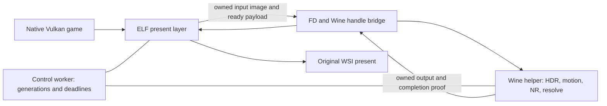

# NR for native Linux Vulkan applications

Design assessment, 2026-10-15; Retoque baseline `24a10942`. No implementation or GPU experiment is
part of this change. “Native” here means an ELF Linux application using Vulkan, not a Windows
application using Vulkan through Proton. The latter already has a Retoque present host.

## Recommendation

Do **step 0, measurements only**, before committing to a native product. Give native NGX the first
probe: the installed Linux core already contains NR identifiers, although no publicly shipped
NVIDIA Linux NR model was found. A working native feature would remove the hardest boundary.
If that fails, a separately written implicit layer plus a Wine helper is technically plausible,
but its handle bridge, crash behavior and total latency need proof. Retaining Proton-only support
is a valid outcome if those gates fail. Do not promise “zero-copy native NR” from an extension list.

| Option | Feasibility today | Main benefit | Blocking evidence / cost |
|---|---|---|---|
| **(a) ELF layer + Wine-hosted Windows NR** | Conditional; public prior art and our Windows Vulkan model path support the architecture, not our cross-process implementation | Reuses the model and much of Retoque's Vulkan processing | Exact runner's memory **and semaphore** interop, safe timeout, extra copies/scheduling and latency |
| **(b) ELF layer + native Linux NGX** | Native core exists and is NR-aware by static inspection; actual feature-18 load/evaluate is **unverified** | No Wine/helper/IPC requirement; record processing with the native frame | No NVIDIA native NR binary/public NR contract found in the inspected SDK distribution |
| **(c) Keep the existing routes** | Feasible now | No new runtime dependency or cross-process failure domain | Native Linux games remain uncovered; reconsider when (a) is measured or (b) becomes available |

The first target would be one x86-64 application, one NVIDIA GPU, one selected swapchain, SDR and
no FG. Multi-GPU, 32-bit clients, OpenGL, capture of arbitrary desktop windows, anti-cheat titles,
and a model reimplementation are outside this proposal. A present layer sees HUD/post-processing
and lacks engine depth/motion; it cannot promise the quality or edit point of the upscaler route.

## Evidence: what native NGX does and does not establish

NVIDIA distinguishes the native NGX core, its optional updater, and a separate NGX core DLL for
Proton. The updater downloads feature updates; it is not a PE loader or a statement that every
feature exists on Linux. Its configuration defaults to updater disabled when unspecified. See
[NVIDIA 615.78.08 NGX documentation](https://download.nvidia.com/XFree86/Linux-x86_64/615.78.08/README/ngx.html).

The public [NVIDIA DLSS SDK Linux x86-64 release directory](https://github.com/NVIDIA/DLSS/tree/374959484e79a640feaba44c93ac8cfb0a03f5b5/lib/Linux_x86_64/rel)
contains `libnvidia-ngx-dlss.so.310.9.1`, `libnvidia-ngx-dlssd.so.310.9.1` and
`libnvidia-ngx-dlssg.so.310.9.1`: SR, RR and FG, respectively. The repository tree at that revision
has no NR-named model, including its Linux aarch64 directories. Its
[feature enum](https://github.com/NVIDIA/DLSS/blob/374959484e79a640feaba44c93ac8cfb0a03f5b5/include/nvsdk_ngx_defs.h#L167-L215)
still calls numeric feature 18 `NVSDK_NGX_Feature_Reserved18`. These are distribution/API facts,
not proof that all driver-internal support is absent or that no private/native model exists.

Read-only inspection on this workstation found more than that public enum suggests:

| Local evidence | What it proves |
|---|---|
| `file /usr/lib/libnvidia-ngx.so.615.78.08`: x86-64 ELF shared object | A native core is installed |
| Dynamic exports include `NVSDK_NGX_VULKAN_GetCapabilityParameters`, `GetFeatureRequirements`, `CreateFeature` | Native Vulkan entry points exist; exports alone do not prove NR works |
| Printable identifiers include `DLSSNR.Available`, `DLSSNR.NeedsUpdatedDriver`, `DLSSNR.FeatureInitResult`, `DLSSNR`, `dlssnr` | The binary contains NR-related strings; it contradicts a blanket “Linux core knows nothing about NR” claim |
| `file /usr/lib/nvidia/wine/_nvngx.dll`: x86-64 PE DLL | The Proton core is a different platform artifact |
| Installed `nvidia-utils` file list has native core/updater and Wine DLLs, no native NR model | This package does not supply that model; not an exhaustive search of NVIDIA's servers |

Native-core SHA-256 for reproducibility:
`85da2399cceeb954b8dc2753cc9bb50ddabd1baf847d8664b85374cc99b03990`.
Commands used were `pacman -Q/-Ql`, `file`, `nm -D`, `strings`, and `sha256sum`; none loaded NGX.

**Answer to “can native NGX load feature 18?”:** it cannot yet be answered affirmatively from
these primary sources and static evidence. The core appears aware of NR, but no native
create/evaluate was run. **Answer to “is there a native Linux NR model?”:** none was found in the
inspected official SDK or installed driver package. Do not turn this bounded negative finding
into a universal impossibility claim. A PE `nvngx_dlssnr.dll` is not an ELF feature library; simply
renaming it, changing its search path or enabling the updater does not supply a native ABI.
Step 0 must distinguish missing feature/model from denied, invalid-parameter and unsupported-device
results. A successful core init or `Available=1` is still not a completed NR evaluation.

Retoque's current proof is different: [the Vulkan host's Stage 3 and HDR results](nr-vulkan-present-host.md#stage-3-as-built-2026-10-14)
exercise the PE forwarder/model under Proton. `DlssNrFeature_Vk.cpp` loads the forwarder with
Win32 calls and uses NGX capability objects supplied by that runtime. This is not a Linux ELF
library ready to link. Do not transplant its private PE parameter/vtable assumptions into native NGX.

## Prior art and licensing boundary

Only DLSS5VKLayer's **README and issues** were read for this assessment. No clone, source files,
shaders, patches, binaries or linked implementation notes were inspected or copied. Its
[README](https://github.com/bmitch87/DLSS5VKLayer/blob/main/README.md) describes an experimental
implicit layer with a Wine-hosted Windows model, DMA-BUF and host-copy transports, HDR and motion
support. That makes (a) credible as an architecture; it is not validation of our proposed protocol.
Its container-path warning also makes host/container endpoint visibility a required test.

Issue #13's [final correction](https://github.com/bmitch87/DLSS5VKLayer/issues/13#issuecomment-5645501048)
retracts the original IPC-bubble explanation: the cited optical-flow time had omitted inference.
The author reports inference scaling from 2.59 to 6.52 ms across model sizes and only 0.23 ms
recovered by consolidating waits. These RTX 5090 measurements are not RTX 4090 predictions.
[Issue #18](https://github.com/bmitch87/DLSS5VKLayer/issues/18) reports model creation needing a
working NVAPI/DXGI environment even with Vulkan inputs: helper dependency checks must include it.
[Issue #21's resolution](https://github.com/bmitch87/DLSS5VKLayer/issues/21#issuecomment-5744820603)
attributes its Ada failure to power delivery, not the layer. Do not cite its opening GPU-hang
report as proof of an NR/Ada defect. None of these reports is a fresh test on this machine.

As in [Evidence and the licensing boundary](nr-vulkan-present-host.md#evidence-and-the-licensing-boundary),
Retoque is GPL-3.0 and DLSS5VKLayer is AGPL-3.0. This proposal keeps an explicit no-copy boundary:
derive implementation from Retoque, primary API contracts and our own tests; do not translate their
source or adopt their IPC ABI. A process boundary is not a substitute for licensing review if code
is later combined. NVIDIA model/core redistribution rights remain separate from Retoque's license;
use operator-supplied, identified binaries in experiments, not bundled model downloads. An unofficial
model reimplementation mentioned in [issue #32](https://github.com/bmitch87/DLSS5VKLayer/issues/32)
is not evidence that NVIDIA ships a native NR feature, and is outside this three-option study.

## Option (a): two API domains, one GPU, an explicit bridge

The proposed ELF layer owns WSI and the application-facing transport. A private helper process
runs Retoque's PE Vulkan model backend on its own logical device, on the same physical GPU.
The helper never receives a game `VkImage`, `VkQueue`, command buffer or pointer as a usable handle.
It imports separately allocated shared resources. Shared host memory carries versioned settings,
sequence/epoch IDs and status; it does not make GPU pixels or caches coherent.

### The FD / HANDLE boundary is a gate, not plumbing already solved

Use `VK_KHR_external_memory_fd` and `VK_KHR_external_semaphore_fd` on the ELF side. Query each
specific format/tiling/usage/handle combination, import/export bits and dedicated-allocation
requirements; a device extension string alone is insufficient. Start with same-driver opaque-FD
sharing. Treat DMA-BUF as a separately negotiated path with its own format/modifier requirements,
not an interchangeable opaque FD. See Khronos's
[external image query](https://docs.vulkan.org/refpages/latest/refpages/source/VkPhysicalDeviceExternalImageFormatInfo.html),
[returned capabilities](https://docs.vulkan.org/refpages/latest/refpages/source/VkExternalImageFormatProperties.html)
and [handle types](https://docs.vulkan.org/refpages/latest/refpages/source/VkExternalMemoryHandleTypeFlagBits.html).

Valve's Wine snapshot `b2a60dcd1454b89e7f8e7fc1c6026f6bfcc3971e` explicitly hides the FD extensions
from PE applications in
[winevulkan's extension list](https://github.com/ValveSoftware/wine/blob/b2a60dcd1454b89e7f8e7fc1c6026f6bfcc3971e/dlls/winevulkan/make_vulkan).
Its [win32u Vulkan implementation](https://github.com/ValveSoftware/wine/blob/b2a60dcd1454b89e7f8e7fc1c6026f6bfcc3971e/dlls/win32u/vulkan.c)
maps Win32 sharing to host FD facilities. This establishes that Wine translates the platforms;
it does **not** establish a public API for importing an arbitrary external Linux FD into our PE
helper. This source snapshot is not a claim about the exact installed GE-Proton binary.

Step 0 must identify a working, maintainable adapter: for example a narrowly scoped native side
of the Wine helper that receives FDs and cooperates with that runner's Wine handle machinery.
A custom Wine Unix-side module or runner patch is a possible research dependency, not an assumed
portable solution. Inspect/test both memory and semaphore translations, including ownership and
close rules. If it needs unsupported internals, pin their version and price that maintenance into
the decision. Never cast an FD integer to `HANDLE`, reuse a numeric handle from another process,
or feed native dispatchable Vulkan objects to Wine wrappers without a proven translation.

Send FDs through an authenticated local Unix socket using descriptor passing, not numbers in SHM.
Handshake includes protocol version, session nonce, process/device generation, GPU/driver identity,
format, extent, colour profile, allocation size/offset and handle types. Match the relevant
[device/driver UUIDs](https://docs.vulkan.org/refpages/latest/refpages/source/VkPhysicalDeviceIDProperties.html)
before any import; GPU names or index 0 are insufficient. Allocate exportable offscreen images
from the start, using the required
[external-image creation information](https://docs.vulkan.org/refpages/latest/refpages/source/VkExternalMemoryImageCreateInfo.html).
Do not assume swapchain allocations can be exported. Audit successful-import ownership transfer
and failure cleanup under the [FD import contract](https://docs.vulkan.org/refpages/latest/refpages/source/VkImportMemoryFdInfoKHR.html).

### Proposed frame and failure contract

This is our design, to be falsified by the transport probes before integration:

1. Before taking application waits, choose an idle, fully retired slot and ready helper product.
   Prepare all native work. Busy/building/unsupported means downstream present unchanged, once.
2. The native copy submit consumes **all** original present waits once, copies the image to owned
   input, and restores its WSI layout/ownership. It signals independent native-pass-through and
   helper-input dependencies. The swapchain remains original; the helper cannot modify it.
3. Release shared-image ownership to the external domain; the helper acquires, processes, releases
   input/output back and signals completion. Native and helper queue-family numbers are separate
   namespaces. Equal integers do not remove external ownership transfers. Specify matching
   layouts/subresources and transfer/compute access scopes according to the
   [Vulkan synchronization contract](https://docs.vulkan.org/spec/latest/chapters/synchronization.html).
4. For the first integrated mode, use a **bounded same-frame deadline**. Only after worker-observed
   helper GPU completion may native work wait on its already-completed payload, acquire output,
   consume the native-copy dependency once, copy back, restore WSI ownership and signal the final
   present semaphore. A SHM “submitted” flag is not completion. Present waits on the native
   completion chain and is called exactly once.
5. On deadline expiry, present the untouched original via the native-copy dependency; keep the
   helper-owned slot quarantined until both endpoints' work/ownership are resolved. Discard late
   results by sequence/epoch, never put frame N's edit on frame N+1. Exhausted quarantine capacity
   disables new requests rather than allocating forever. Unconsumed binary signals also prevent
   slot reuse: drain them through a proven wait or retire the payload, never re-signal blindly.
   Failed submissions use the existing host's partial-chain discipline; never forward consumed
   original waits a second time.

Keep binary WSI semaphores distinct from IPC semaphores. Prefer per-slot persistent opaque
semaphore payloads initially; timeline transport needs explicit capability/type compatibility
on both endpoints. A sync FD is a one-shot, temporary payload, not a reusable opaque semaphore.
See [external semaphore queries](https://docs.vulkan.org/refpages/latest/refpages/source/VkPhysicalDeviceExternalSemaphoreInfo.html)
and [FD semaphore imports](https://docs.vulkan.org/refpages/latest/refpages/source/VkImportSemaphoreFdInfoKHR.html).
Submission completion does not prove presentation has consumed its wait: retain the existing
reacquisition/presentation-completion retirement rules described by the
[Khronos semaphore reuse guide](https://docs.vulkan.org/guide/latest/swapchain_semaphore_reuse.html).

Never queue an unbounded game-GPU wait on an unsignalled helper-owned semaphore and then claim
that a CPU timeout can cancel it. It cannot. A later fully GPU-chained mode might reduce CPU waits,
but requires a separately proven recovery contract; helper process isolation does not isolate a
shared physical GPU from a device loss. Likewise, presenting N−1 hides some dependency but adds
frame age/latency and complicates UI/input and cuts. Neither is the default rescue for a slow helper.

An initial experimental same-frame cap could be `min(8 ms, target frame interval)`; it is a proposed
acceptance parameter, **not measured sufficiency**. If the 4090 model cannot finish within it,
report the skipped fraction and reject this mode rather than quietly lengthening the wait. At
165 Hz the whole interval is about 6.06 ms. A low CPU overhead number cannot excuse a large added
present latency. No sleeps, opaque NGX work, handle import, allocation or process startup belongs
under native transport/queue locks. A control worker owns IPC and helper health; the PE builder
owns model creation. Neither may call back for a game queue lock while present waits for completion.

Resize/colour-space changes create a new generation off present. Old slots retire only after
**both devices'** submitted work and required ownership returns complete; draining the game device
alone is insufficient. On lost devices abandon their GPU objects, as required by
[DEVELOPMENT invariant 8](DEVELOPMENT.md#1-invariants-must-always-hold). Dead-helper resources with
uncertain use remain bounded/quarantined; clean restart negotiates a new generation. Never free
an uncertain import just because the process stopped responding. No GPU API recovery guarantee
is implied after a physical device failure.

### Costs to measure, not hide behind “zero-copy”

Even with no CPU pixel copy, a conservative shared-image path copies swapchain → owned input and
owned output → swapchain. Those two copies touch at least four image payloads in GPU memory
(each reads and writes), before HDR, motion, model, resolve and possible helper-local copies.
The model may not accept the exportable allocation's format/usage/layout, adding another pair.

At 3440×1440, one RGBA8/packed-10-bit image is 19,814,400 bytes (18.90 MiB); RGBA16F is 39,628,800
bytes (37.79 MiB). Two GPU copies therefore imply at least 75.59 or 151.17 MiB of GPU-memory
traffic per processed frame. A ring of three slots with separate input/output allocations costs
113.38 or 226.76 MiB, excluding model/history/HDR/reference resources. These are arithmetic byte
counts, not a bandwidth-derived latency prediction.

A CPU-SHM baseline must usually download on the game device, upload in the helper, download its
result and upload on the game device: four full payload transfers, plus host copying/coherency.
At 60 processed frames/s that is about 4.76 GB/s (RGBA8) or 9.51 GB/s (FP16) aggregate link traffic,
before padding/extra passes. It is a useful correctness/performance control, not an acceptable
default merely because it works. Pipeline all helper GPU stages without per-stage CPU drains;
timestamp copies, conversion, synthesized motion, **NR itself**, and resolve separately. Also
measure CPU wake/scheduling and present delay; GPU timestamps from separate devices must not be
subtracted as if they shared a calibrated origin.

## Reusing Retoque without pretending the DLL is portable

| Existing component at this baseline | Reuse / required boundary |
|---|---|
| `DlssNr_VkPresentTransport.h`, `VkPresentRegistry.h`, `VkPresentNr.h` | Reuse state/eligibility/slot policy and host tests; add cross-process generation and two-sided retirement tests |
| `DlssNr_VkPresentHost.cpp` | Reuse the transfer round-trip and once-only wait/present contract; replace Detours/Win32 hook discovery with ELF loader dispatch. Current source includes PCH, State, Config and Windows proxies |
| `DlssNr_VkPresentBuild.h`, `DlssNrFeature_Vk.cpp` | Keep ready-product adoption, bounded build states, watchdog and orphan/loss semantics in the helper; add exported-image identity to its build key. No creation on present |
| `forwarder/dlssnr_forwarder.cpp`, `DlssNr_Vk.cpp` | Keep the existing PE model/capability ABI and shared composition SPIR-V inside Wine; native NGX would need a separately verified adapter |
| `SynthMotion_Vk.{h,cpp}` and SPIR-V | Run in the helper on the model's working-size proxy, reset on sequence gaps/cuts; commit history on submitted work, read cut flags after completion. No guide transfer is needed initially |
| `DlssNr_PresentHdr_Vk.h` and shared HDR SPIR-V | Keep decode/NR/encode with the original encoded frame as reference inside the helper; transfer raw HDR codes without an 8-bit detour |

The ELF layer requires the loader negotiation and instance/device dispatch chain, including
proc-address interception, queue retrieval, swapchain lifetime, acquire/present and submission
serialization. This is a new frontend, governed by
[Khronos's layer interface](https://github.com/KhronosGroup/Vulkan-Loader/blob/main/docs/LoaderLayerInterface.md).
Use a per-application opt-in manifest/environment gate and disable it explicitly in the helper;
no globally enabled desktop layer. Off means no helper, feature/extension additions or altered
submit/present path. Copy create-info/pNext inputs only where supported; unsupported multi-swapchain,
device-group, protected or special present semantics must pass through, not be silently dropped.
The native application needs transport capabilities, not the helper's NGX extension set.

HDR remains a separate gate after SDR: preserve colour space and packed format, alpha, negative
scRGB and highlights. Use the existing 203-nit fallback with the source logged until a reliable
native SDR-white source is demonstrated. A2R10 presentation support is not storage support;
retain the checked A2B10 intermediate/reorder path. Build conversion resources off present too.
The existing [Vulkan HDR results](nr-vulkan-present-host.md#hdr-as-built-and-measured) do not prove
external-memory format support or native Wayland HDR WSI behavior. Synthesized motion costs GPU
time and has no engine depth; HUD, disocclusion and cuts still require visual evidence.

## Staged plan and decision gates

These are **future experiments**, not commands executed or implementation authorized by this
design-only task. Step 0 produces a result table and a go/no-go decision, not a shipping layer.

### Step 0 — measure the unknowns in standalone probes

1. **Inventory and identity.** Record driver/core/model hashes, runner build, device/driver UUIDs,
   queue families, memory budgets, formats and every required external handle property. Enumerate
   native Wayland and XWayland surfaces separately. Keep clock/power settings unchanged and log
   them; a GPU name is not a performance control. Record software dependencies, not just “Proton.”
2. **Native NGX first.** With the public SDK in an isolated native probe, verify a known-supported
   SR feature as a positive control. Then query feature 18 and its capability/requirements results
   and record exact statuses and selected module paths. If a legitimate native model is available,
   create/evaluate deterministic images, prove fence completion and pixel changes versus an
   identity control. If only a PE model exists, record that hard limitation; do not invent a
   vtable, patch the native core, disable signature checks or mistake a missing library for a
   failed GPU capability. No updater/system configuration changes to obtain a result silently.
3. **Transport without NR.** Standalone native producer and PE consumer, no injection. Compare
   CPU-SHM with opaque-FD memory plus semaphore bridging; DMA-BUF is optional/separate. Prove
   same-GPU identity, patterns/alpha round-trip, no read-before-write, proper FD/HANDLE ownership,
   1/2/3 slots and exact generation matching. Test helper termination before import, after input
   submission, during work and after output signal; stall and delayed replies too. Validation on
   both devices plus pixel/sequence controls is necessary: validation cannot see every IPC hazard.
4. **Cost isolation.** For 1280×720, 1920×1080, 3440×1440 and 3840×2160, compare no-work IPC,
   identity transport, conversion-only, NR without motion, NR with motion, and CPU-SHM. Use 300
   warm-up and at least 2,000 measured frames per condition, three repetitions. Report median,
   p95/p99, max, processed/skipped counts, end-to-end response time, CPU consumption, GPU stage
   times, VRAM and helper startup/build time separately. Repeat with controlled concurrent GPU
   rendering; an idle vkcube cannot predict contention in a game. No model dispatch is inferred
   from optical-flow timing or a return code without completion.
5. **Decision.** Prefer (b) only with a native model and completed evaluations. Advance (a) only
   with a reproducible bridge on a named runner, exact identity controls, bounded failure behavior,
   and an acceptable latency/coverage curve at the proposed deadline. Proposed transport-only
   gate at 3440×1440: median ≤1 ms and p99 ≤2 ms added over the same-process identity control;
   require ≥99% processed coverage in the chosen whole-NR deadline experiment, with all skips
   reported. These are product targets to discuss after measurement, not claims about this GPU.
   If no result meets the budget, choose (c) rather than conceal frame age or force a larger wait.

The positive-control failure means “probe/environment invalid,” not “NR unsupported.” Save negative
controls and raw timings alongside the summary. Step 0 may need disposable probe programs in a
later task, but no production transport refactor, permanent manifest or deployment belongs to it.

### Step 1 — native pass-through and identity transport

Only after step 0 passes, write the opt-in ELF layer frontend using our own contracts. Establish
off/default identity, correct loader ordering and semaphore takeover on vkcube. First same-family,
then supported cross-family/concurrent/exclusive routes; resize, failed presents, rapid toggle,
helper restart, mixed swapchains and live-device teardown. Test malformed IPC and descriptor
leaks. Require zero layer-originated validation errors and unchanged originals with NR disabled.

### Step 2 — model on SDR, same-frame bounded mode

Attach the existing PE backend, off-present builds, real completion tickets and watchdog. Start
with zero guides and deterministic motion/cut/HUD patterns, then synthesized motion. Add a native
game only after the pattern harness and process-failure controls pass. No FG or overlay interception
beyond defined chaining; do not use late output as a performance shortcut. Measure application
present delay and frame age as well as helper throughput. Re-run with the Steam overlay and with
native NGX SR in the application: separate processes avoid pointer sharing, not GPU contention.

### Step 3 — HDR and operational coverage

Exercise actual native HDR10/scRGB surfaces if offered; otherwise use offscreen images and label
the missing WSI coverage. Exact conversion-only controls, real model edits, half-scale motion,
resize/overlap, colours/highlights and device-loss policy each need separate results. Test Steam
Linux Runtime namespace visibility, endpoint permissions and helper opt-out. Then consider more
applications/32-bit packaging and pacing coexistence, with new evidence rather than a universal
Linux claim. A no-Wine backend, if step 0 establishes one, reuses the same native frontend and
colour/temporal contracts while dropping IPC and its extra allocations.

## What this workstation can test

Live read-only inventory on 2026-10-15 confirmed RTX 4090 (24 GiB), driver 615.78.08,
`nvidia-utils 615.78.08-1`, Vulkan loader/tools 1.4.363.0 and Hyprland 0.56.2. `vkcube` is installed;
the current display is 3440×1440 at 165 Hz, with VRR intentionally off. Nothing in this assessment
changes display, power, runner or driver settings.

- Native vkcube is the immediately available ELF/WSI baseline. Confirm its chosen WSI backend at
  execution; separately test Wayland and XWayland where supported. Its rotating cube tests transport,
  not NR appearance on faces, foliage, text or a busy scene.
- The existing real-model `tests/vulkan-present-host` cases are a PE-side regression and comparison
  baseline. They do not establish a native layer or FD/HANDLE bridge. Reuse their image patterns and
  validation controls in a later standalone native harness.
- A suitable offline native Vulkan game or native Vulkan emulator can follow. First verify an ELF
  executable and actual Vulkan renderer; a Windows Vulkan game under Proton is not the native test.
  This task did not establish a specific installed native game's eligibility. vkcube is sufficient
  to start, and no game installation or launch is needed for this design.
- Test the same producer inside/outside Steam Linux Runtime. Use a private, user-owned endpoint,
  peer checks and explicit namespace sharing; do not assume identical paths name the same SHM
  object or make a world-writable global control file. Check helper PID **and generation** so PID
  reuse cannot revive old state. Multi-user and two-game sessions must remain isolated.

Before future GPU probes, ensure no game is running, check available VRAM and avoid simultaneous
agents' GPU work. Every Wine/MSVC-prefix use must take the shared prefix lock and abort if the game
maps check is nonempty. This note runs no Wine, NGX, Vulkan workload, build, test game or layer install.

## Risks and stop conditions

| Risk | Evidence/gate that controls the decision |
|---|---|
| Native NR binary/API availability | Core identifiers are promising, not a working feature; step 0 must resolve model loading and evaluation |
| Runner-specific handle adapter | Prove both memory and sync import/export; reject an unmaintainable private-ABI dependency |
| Latency and same-GPU contention | Identity/NR/concurrent-render controls and processed coverage; a fast IPC handshake does not remove inference |
| Timeout after waits are consumed | Preserve native fallback chain; never wait on an unproven helper signal or recycle a quarantined slot |
| Helper/GPU failure | Bounded resources and no stale write-back; process isolation cannot guarantee compositor survival after device loss |
| HDR/format assumptions | Exact format+usage+external-handle queries; offscreen success is not HDR WSI success |
| Motion/HUD/model quality | Held scene, pan, cuts and UI comparisons at the actual display output, with timing separate from captures |
| Licensing/distribution | Independent implementation; no AGPL transplant and no assumption of NVIDIA binary redistribution rights |
| Scope/maintenance | Opt-in one-game path first; no default global layer, no FG/multi-GPU/32-bit promises |

If native support remains unavailable and the helper cannot meet correctness, maintenance and
latency gates, defer the route and keep the existing Proton path. The useful deliverable is then
an honest measurement record and a small list of missing capabilities, not a native feature that
silently presents stale frames or risks indefinite waits.

## Validation of this note

Read the Retoque present-host Stage 3, off-present build, Stage 5 and HDR contracts and the development
invariants; checked current source dependencies and primary sources linked above. Performed only
read-only hardware/package/binary inspection. No native feature-18 query, model load, FD import,
surface enumeration, inference or game measurement was performed. Documentation link targets and
whitespace are checked before commit; no build or host/GPU test is required for this docs-only change.
